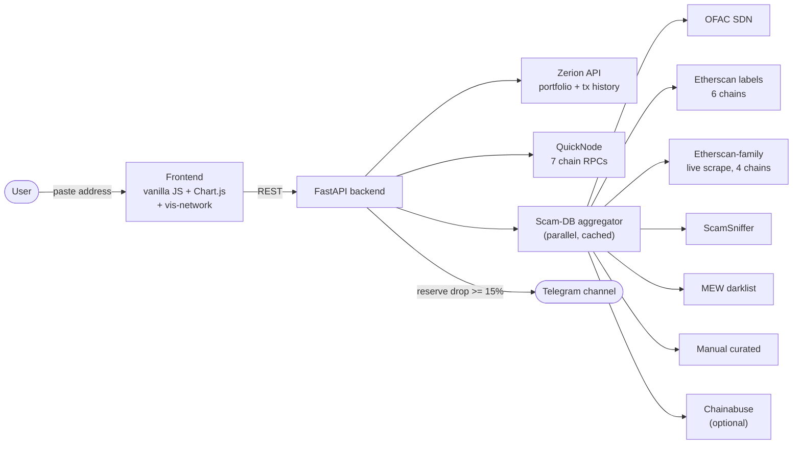

# Kalkan

**Kalkan** ("shield" in Turkish) is a free public tool for checking crypto
addresses and getting an early warning before an exit scam — paste an
address, get a plain-English report. No signup, no B2B contract, no
compliance department required.

<p>
  
  
  
  
  
</p>

## Why

Turkey is one of the world's leading countries for retail crypto adoption —
people have used crypto for years to protect savings from lira inflation.
In 2021, the collapse of the Thodex exchange (its founder fled with roughly
**$2 billion**, leaving **~400,000 users** without their funds) happened
with zero early warning: nobody saw the reserves draining before it was too
late. Existing AML/forensics tools (Chainalysis, TRM, Crystal) are sold to
exchanges for their own compliance — an ordinary depositor can't access
them.

Kalkan does two things for free, no account needed:

- **Check any address** — portfolio, recent transactions, a risk score, and
  every scam-database flag it matches, across 7 EVM chains.
- **Watch reserve wallets** — background polling of a small watchlist,
  Telegram alerts if reserves drop ≥15% between polls.

## Features

- 🔍 Address lookup — live portfolio + token positions + transaction
  history via Zerion, with a QuickNode fallback for native balance
- 🚦 Risk score (0–100, green/yellow/red) from 7 independent scam-flag
  sources, checked in parallel
- 🕸️ Interactive fund-flow graph (vis-network) for the checked address
- 👁️ Watchlist — reserve monitoring with historical sparkline charts and
  Telegram alerts on anomalous drops
- 📤 Full report export (JSON or a multi-section CSV), not just a flags
  table
- 🌐 RU / EN / TR interface, backend returns language-neutral reason
  codes so every string is really translated, not just the UI chrome

## Architecture



## Scam-flag coverage

Every check queries all applicable sources in parallel and takes the worst
severity found. Counts below are addresses actually flagged as risky (not
neutral entity tags like "exchange" or "DeFi protocol") — live numbers from
the running cache, refreshed on the configured TTL.

| Source | Coverage | Flagged addresses |
|---|---|---|
| OFAC SDN | sanctioned entities, all chains | 1,043 (124 in `0x…` EVM format) |
| Etherscan community labels | 6 chains, own taxonomy each | 634 |
| Etherscan-family live scrape | 4 chains (Cloudflare blocks the other 3) | per-address, not a bulk count |
| ScamSniffer | phishing/scam blacklist | 2,530 |
| MyEtherWallet darklist | official, human-reviewed | 652 |
| Manual curated | confirmed incidents no automated source covers yet | 6 |
| Chainabuse | community reports | optional, needs an API key |

**Etherscan community labels, by chain** (addresses actually risk-flagged / total addresses labeled on that chain):

```
ethereum   ██████████████████████████████████████████████████  554 / 23,288
polygon    ████                                                  46 /  4,724
arbitrum   ███                                                   27 /    507
avalanche  ██                                                    20 /    618
bsc        █                                                     12 /  2,875
optimism   █                                                      8 /    470
```

Each chain carries a genuinely different risk-category taxonomy — verified
by hand, not assumed: `ethereum` uses `ofac-sanctions-lists` /
`high-risk` / `blocked` / `something-fishy` / `flagged-by-sec`;
`arbitrum` / `avalanche` / `optimism` use `exploit` / `phish-hack`;
`bsc` uses `scam` (including real `Fake_Phishing*` entries); `polygon`
uses `blocked` / `exploit` / `scam`.

## Chain coverage

| Chain | RPC (QuickNode) | Bulk label dataset | Live scrape |
|---|---|---|---|
| Ethereum | ✅ | ✅ 23,288 addrs | ✅ etherscan.io |
| Arbitrum | ✅ | ✅ 507 addrs | ❌ Cloudflare-blocked |
| Base | ✅ | ❌ not in dataset | ✅ basescan.org |
| Polygon | ✅ | ✅ 4,724 addrs | ✅ polygonscan.com |
| Optimism | ✅ | ✅ 470 addrs | ❌ Cloudflare-blocked |
| BNB Chain | ✅ | ✅ 2,875 addrs | ❌ Cloudflare-blocked |
| Avalanche | ✅ | ✅ 618 addrs | ✅ snowscan.xyz |

## Getting started

```bash
cd backend
python3 -m venv .venv && source .venv/bin/activate
pip install -r requirements.txt
cp ../.env.example ../.env   # fill in real keys
uvicorn app.main:app --reload --port 8000
```

The frontend is served by the same FastAPI process at `/`.

**Required:** `ZERION_API_KEY`, at least one `QUICKNODE_RPC_URL_*`.
**Optional:** `CHAINABUSE_API_KEY`, `TELEGRAM_BOT_TOKEN` /
`TELEGRAM_CHANNEL_ID` (watchlist alerts), `ETHERSCAN_SCRAPE_ENABLED`
(on by default — flip to `false` if an explorer starts blocking it).
See `.env.example` for the full list.

## API

| Endpoint | What it does |
|---|---|
| `GET /api/address/{address}` | Full report: portfolio, transactions, flags, risk score |
| `GET /api/address/{address}/export?format=json\|csv` | Same report, downloadable |
| `GET /api/watchlist` | Current watchlist snapshot + history |
| `POST /api/watchlist/poll` | Trigger a poll cycle immediately |
| `GET /api/stats` | Live counters (checks today, chains configured, …) |
| `GET /api/health` | Which providers are configured |

## Known limitations

- **CryptoScamDB** is effectively dead as of 2026 (live API returns 502, no
  dataset left in its GitHub org) — the client is kept, degrades silently,
  contributes nothing.
- **Chainabuse** auth format is unverified against a real key — disables
  itself cleanly if no key is set.
- **Arbitrum / BSC / Optimism** explorers block plain-HTTP scraping via
  Cloudflare — covered by the bulk dataset + manual curation instead of a
  live scrape.
- **Base** has no bulk label dataset in the source we use — live scrape
  only.

## Author

[GitHub](https://github.com/0xBreak) · [X](https://x.com/0xBreak) ·
[Telegram](https://t.me/0xBreak)
